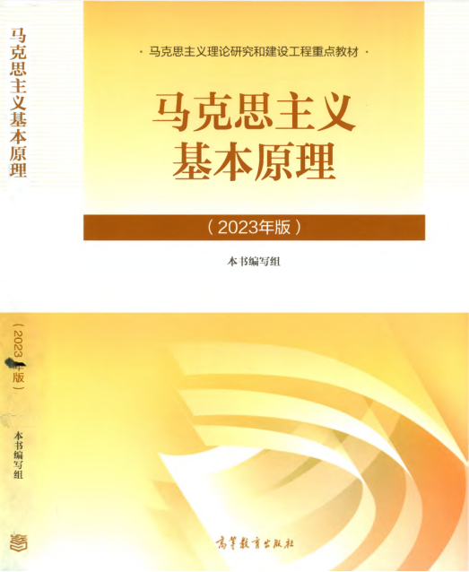

# 导论阅读提纲

## 阅读范围

- 教材：马克思主义基本原理（2023 年版）
- 阅读入口：PDF 原件中的导论
- 资料来源：[安徽艺术学院](https://www.ahua.edu.cn/marx/2023/0524/c844a24933/page.htm)

## 阅读顺序

先了解马克思主义产生的历史背景，再梳理它所讨论的主要问题，最后联系自己的学习或教学情境。

### 三个阅读问题

1. 一个理论怎样回应其产生时代的问题？
2. 理论、实践与历史背景之间有什么联系？
3. 哪些概念需要回到教材原文核对？

## 课堂使用

| 环节 | 活动 | 产出 |
| --- | --- | --- |
| 课前 | 独立阅读导论 | 写下一个问题 |
| 课堂 | 结合实例讨论 | 提出解释与依据 |
| 课后 | 回到原件核对 | 完善阅读笔记 |

> 这份提纲属于整理与解读，引用教材时请核对 PDF 原件及页码。

## 阅读记录

- [ ] 完成导论阅读
- [ ] 整理概念之间的关系
- [ ] 核对课堂引用的页码

## 配图

