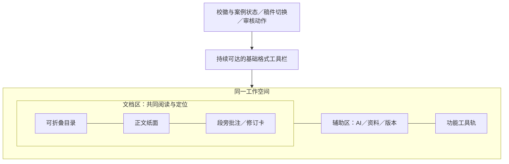

# CKEditor 工作台拆解与案例库原型规格
## 目标与决策状态
教师能在同一工作空间阅读正文、定位批注、预览修改并与 AI 讨论；常用操作靠近当前任务，空间随开启的功能分配。保留上海大学品牌与已确认功能，探索布局和组件细节。
用户已选中这组交互作为深入研究方向，尚未验收具体原型。下文“候选规格”是可操作的建议，不是已经批准实施的全部功能。
## 七张截图逐项映射
| 图 | 观察 | 解决的问题 | 候选规格 |
| --- | --- | --- | --- |
| 1 | 选区附近短工具条，AI 菜单逐层展开 | 长文操作不必回页首 | 常用格式＋批注＋问 AI，少量首层入口，复杂操作进下一层 |
| 2 | 命令搜索、分组、子菜单 | 不会写提示词时也能开始 | 研究“找命令/Skill→携带选区→明确执行方式”，不机械恢复全部旧快捷按钮 |
| 3 | 侧边窄工具轨切换 Chat、历史、Review、翻译 | 功能切换不占满水平空间 | 工具轨只负责切换，悬停/键盘聚焦有名称；文档版本与对话历史明确区分 |
| 4 | 输入框下模型、联网、reasoning | 用户知道这次调用采用什么能力 | 设置与正文上下文分层；只展示真实可用能力，联网仍 Later |
| 5 | 新选区 chip 有短暂反馈，可删除 | 知道哪些内容已带入下一条消息 | 可见原文摘要＋展开＋定位＋移除；发送后快照保留，失焦不误清 |
| 6 | 对话标题自动概括当前任务 | 从历史中认出一次讨论 | 自动会话名独立于文章标题；改名权仍归用户 |
| 7 | 目录、纸面、段旁批注、AI 可同时看见 | 讨论与核对修改不必来回切 Tab | 文档工作区包含目录/正文/批注，AI 是可收起的相邻区域 |
图 1 浮条的链条图标是“链接”；批注入口需要案例库按自身需求加入，不能把它误标成 CKEditor 的批注图标。
## 证据层次
| 类型 | 本轮实际核查 | 不能推导的结论 |
| --- | --- | --- |
| 用户试用 | 七张截图和对交互、比例的反馈 | 所有控件已成为 M1 新增需求 |
| 独立浏览器 | 匿名打开演示、进入全屏、展开 AI、选中文字出现浮栏；保存 DOM、CSS、1920×1080 截图 | 所有命令可用、接受/拒绝已验证、真实 AI 请求成功 |
| 固定公开源码 | BalloonToolbar、ContextualBalloon、相关公开 CHANGELOG | 在线演示正好运行这个 commit |
| 官方 AI 文档 | 命令类型、上下文策略、侧栏集成和模型能力配置 | premium 内部实现、服务端标题 prompt、实际选用模型 |
| 当前案例库代码 | 布局约束、格式命令、Tiptap 2 BubbleMenu、消息选区字段和默认会话名 | 已经实现下文原型 |
## 空间组织
### 实测参考
匿名全屏演示在 1920×1080 中：顶部菜单/工具栏约 110px；目录区宽 270px；纸面宽约 796px，左边界约 315px；批注轨宽 270px；最右 AI 区含工具轨宽约 495px。纸面中心约 713px，不是屏幕中心 960px。以上来自 `layout-elements.json`，是参考样本，不是案例库必须照抄的尺寸。
正文与段旁批注在同一个横向工作区，批注位置与原文相关联。AI 标题与输入区保持可达，聊天内容在其自身区域浏览。布局会随功能展开改变；仅缩小当前页面外边距不能得到同样体验。
当前案例库 `workbench.css:87` 用 `150px minmax(450px,820px) 410px`、30px 间距并整体居中；批注与 AI 共用右侧 Tab。这解释了纸面居中留白较多，以及对照批注时无法同时持续看 AI 的限制。
### 候选布局

原型从两种密度比较：宽屏同时显示批注和 AI；中等屏幕只展开当前批注卡，并折叠目录或辅助面板。两种都保留相同功能和作用范围。AI 收起时释放空间给文档组，不把正文无限拉宽。
首轮试排建议：1920px 用 200px 目录、约 780px 纸面、260px 批注、约 380px AI；其余给边距、分隔和工具轨。1440px 起不强塞所有列，先折叠目录并仅展示当前批注；更窄时辅助区覆盖或独立展开。具体阈值由原型文本可读性检验，不当作 CKEditor 的断点。
批注随文定位时处理重叠：相邻卡片按文档顺序向下排，当前卡高亮并可回到对应原文；长讨论只展开当前卡，不能为了卡片高度在正文中插空段。AI 面板滚动不驱动正文滚动。
## 浮动工具栏与菜单
### 已核实机制
BalloonToolbar 的公开实现将编辑器与工具栏作为共同焦点域；选择稳定后防抖 200ms 显示，拖选时隐藏，位置根据选择方向与首末行矩形更新；支持 Alt+F10/Esc。宽度约束、菜单分组及滚动重算减少遮挡。ContextualBalloon 用视图栈处理子表单返回，避免链接框和菜单各自散落。
### 候选规格
- 空光标不弹出选区工具条；有效文字选区稳定后显示。首层为加粗、斜体、批注、问 AI；链接与更多格式可经原型决定是否直接放入。
- 鼠标从正文移到工具条、命令搜索框或批注输入框时，原目标仍清楚可见。进入菜单后选区不因 blur 丢失，输入法组合阶段不重定位。
- 格式命令即时作用于当前编辑选区；问 AI/批注只开启相应输入路径。文字格式权限与“引用正文做讨论”的权限分别判定，不能以只读模式一概隐藏所有选区动作。
- 多行、反向选择、文末与窄屏优先把浮栏放进可见边界；不压住主要选区和输入光标。跨段是否允许修订由目标契约决定，不由浮栏显示与否暗示。
- 键盘可进入工具条，箭头移项，Enter 执行；Esc 逐层关闭菜单并回到正文。浮栏消失后选区仍可用于键盘快捷键。
- 保留持续可达的基础工具栏，浮栏作为就近操作入口。两处共享同一命令定义与 active/disabled 状态。
## AI 命令菜单
官方 Quick Actions 有不同副作用：Ask AI 附带上下文后等待输入；Summarize 等聊天命令可直接发起请求；修改类动作先展示候选。外观相近不代表执行行为相同。
### 候选规格
| 入口 | 原型中的推荐行为 | 可见结果 |
| --- | --- | --- |
| 问 AI | 打开现有对话并带入选区，不自动发送 | 原文摘要 chip、聚焦输入框 |
| 插入 Skill | 搜索实际已发布 Skill，选择后插入本条消息块 | Skill 名、可移除、本条消息调用 |
| 总结/解释等快捷命令 | 第一版先预填可编辑提示词，是否允许直接发问待用户选择 | 明确显示将发送的指令与范围 |
| 改写/精简等动作 | 遵守当前修订/独立稿/直写契约，不能直接照抄默认副作用 | 修改前后预览、理由、采用/保留原文 |
菜单搜索用于匹配可见命令或 Skill 名称；自由输入业务意图仍由 LLM 理解。不要用关键词规则把用户的否定、问句变成执行授权。
之前已确认旧快捷按钮由自由对话＋Skill 承接；这轮只提出命令菜单候选，最终清单与即时发送行为仍待用户选择。翻译、语言列表、拼写修复等 CKEditor 默认项不整套复制为新需求。
## 选区上下文与动效
### 已核实机制
CKEditor 默认点击 Ask AI 才附加选区；`alwaysAddSelection` 可配置为随选择自动更新，折叠选择时移除。公开接口可将选区附加到下一条消息。用户截图显示 chip 可删除和截断摘要。
本轮从演示 CSS 读取到 `.ck-ai-chat-context-chip_new-chip` 的 `ck-ai-new-item-flash` 动画及 `.6s/ease-out` 变量；输入框吸引注意的动画另有 `.8s` 配置。这只证明渲染样式存在，不证明用户每一次选择变化均触发，也不构成 premium 完整源码审查。
### 候选状态与契约
| 状态 | 正文反馈 | 输入框反馈 | 退出/变化 |
| --- | --- | --- | --- |
| 浏览选中 | 原生选区与浮栏 | 自动附加或显式加入待原型选择 | 新选择更新临时范围 |
| 已带入本条消息 | 失焦仍有淡色高亮 | 摘要 chip 一次短闪亮，可查看完整原文 | 移除 chip 后不随下条消息发送；不改正文 |
| 输入中 | 保留所引用目标 | 输入框可自由打字，选择摘要不空白 | 点输入框不等于放弃选区 |
| 已发送 | 不持续闪烁 | 消息显示发送时的引用快照 | 后续正文变化不改写历史引文 |
| 目标改变/删除 | 显示原文变化或已删除 | 原引用可回看，旧建议不可误应用 | 新请求按现文重新定位或澄清 |
浏览选区、消息上下文和服务端锁定修订目标分别管理。动画只表示“加入/更新了上下文”，不表示已发送、已读取、已核实或获得写入授权。
chip 展示一行可辨认的原文，长文省略；点击展开完整片段并可返回原位置。不要只显示“3 字”，也不要只显示空的“正文选区：”。发送时持久化经过校验的 quote 与对应文档修订信息。
动效建议先做 150–250ms 的淡入和约 600ms 的单次强调；采用减少动态效果设置时去掉闪亮/位移，静态边框与文字仍表达状态。这是案例库原型参数，不是上游强制规范。
## 侧栏、会话标题与输入框下的控件
侧边工具轨使用已有功能的图标＋可访问名称＋当前态；收起仅收起面板，切回保留草稿、滚动、上下文和运行状态。会话历史与文档历史在名称和图标上避免都叫“历史”。不要把 CKEditor 的 AI Review 按钮误认为案例库的管理员发布审核。
自动标题属于会话导航。公开 CHANGELOG 记录 AI 首次生成标题时播放动画、重开历史不重复；未核查生成 prompt 或服务端算法。
案例库现在 `routes.py:454` 直接取首条输入第一行并截断，具备手动改名，但不是语义摘要。候选方案：首轮形成内容后异步生成短任务名；生成期间显示当前已有临时名；失败不阻塞对话；教师手动改名后不被自动覆盖。切换会话后迟到的标题只更新对应会话，绝不能写进文章标题。
| 控件 | CKEditor 参考 | 案例库处理 |
| --- | --- | --- |
| 模型 | 底部选择，官方说明会话内固定，换模型新建会话 | 可研究运行身份的可见性；是否让教师切换、何时生效另定，不仅接一个下拉框 |
| 联网 | 兼容模型可启用 | Later；M1 正式界面不出现假开关，原型涉及时明确为未来参考 |
| Reasoning | 兼容模型可启用 | 区分请求推理能力和展开已有思考摘要；不能仅改变面板显示就宣称模型开启推理 |
| 资料/选区 | 可附加上下文 | 保留现有确认加入资料与消息内 Skill 边界，不扩大来源权限 |
输入框上方放“本条消息会参考什么”，下方放“本次如何运行”；运行中显示当前步骤、停止按钮和真实持续计时。设置区不能挤掉输入空间或让用户为了发送必须选择模型。
## 批注与修改预览
正文中直接呈现删除/新增痕迹，卡片解释一次修改，并提供预览与采用/保留原文。普通评论与修改建议有可辨认标识；颜色之外加删除线、增删标记及文字。
预览为临时展示层，不自动写入当前教师稿，不触发保存或新版本。关闭预览恢复原阅读位置；采用后通过已有变更链写入，过期目标不能悄悄套用。不要把“标记批注已处理”混同“采用其中的修改”。
“目录＋正文＋段旁卡片”的原型优先支持老师同时看 AI 回复与修改位置；批注讨论正文仍位于侧边，不恢复此前被否定的遮挡正文大浮窗。
管理员退回规则保持总评与关联批注至少一项；批注何时对教师可见、是否合并“要求补充”仍由审核反馈决策票确定。CKEditor 实时共享评论的方式不自动改变本项目审核送达规则。
## 可复用实现与改动位置
| 模块 | 现有基础 | 原型/实施建议 |
| --- | --- | --- |
| 文档空间 | `frontend/src/styles/workbench.css:87`、`WorkbenchView.vue` | 将目录、纸面和批注轨组织为一个文档区，辅助区独立；验证宽窄屏折叠规则 |
| 格式动作 | `EditorToolbar.vue:29` 的命令条 | 共享格式命令列表，增加就近呈现而非两套动作 |
| 浮栏 | `@tiptap/vue-3` 导出的 BubbleMenu；本机 extension-bubble-menu 2.27.2 | 已有焦点保留、防抖、composition 与选区定位；使用项目 Tiptap 2 的 Tippy API，不照抄 Tiptap 3 配置 |
| 选区 | `CanvasEditor.vue` 已有 quote、revision、quoteHash 与 decoration | 保留服务器验证；把临时浏览选择和本条消息上下文分清 |
| chip/消息 | `AgentComposer.vue:104` 只显示字数；`AgentChatPanel.vue:552–556,671` quote 缺失 | 显示摘要和完整原文入口，修复发送快照字段后再加动效 |
| 会话 | `AgentChatPanel.vue:224`、后端 rename_thread 与默认标题 | 复用 thread ID/改名路径，单独定义自动标题，不动文章标题 |
| 运行反馈 | 现有 Run、工具时间线与停止能力 | 按真实事件显示运行状态，不以动画或模型自述代替完成 |
| 批注预览 | `AnnotationFloat.vue`、`AgentArtifactCard.vue`、现有修订与版本链 | 用已有候选数据驱动正文展示层，采用与关闭走原有有效性验证 |
不以换编辑器作为得到这些交互的前提；若以后评估 CKEditor 集成，另行比较许可、服务依赖、文档模型与已有批注/版本链的改造成本。本轮未引入 CKEditor 产品代码或商业包。
## 原型验收清单
| 场景 | 可观察的通过条件 |
| --- | --- |
| 长文底部格式编辑 | 不回页首完成选区加粗，工具条不遮挡当前文字 |
| 反向、多行与窄屏划词 | 浮栏在可见区域，菜单层级能退出，目标保持正确 |
| 从选区到菜单搜索再到输入框 | 高亮与 chip 引文一致，输入焦点可用；无空 quote |
| 中文输入法 | 组合输入期间不抢焦点、不反复闪动浮栏 |
| 删除 chip | 下一条消息不携带被删除的上下文，历史引文保留 |
| 换选区与改正文 | chip 更新可辨认；已发送引文不随现文漂移，旧修订失效有说明 |
| 同看批注与 AI | 点卡片可定位原文，AI 不被切走；滚动聊天不挪动正文 |
| 改前/改后预览 | 用户能指出具体差异，关闭预览正文未变，采用有可恢复路径 |
| 切侧栏与切会话 | 输入草稿、运行与选区归属正确；文档版本不与对话历史混淆 |
| 自动标题 | 语义短标题只更新对应会话，手动名不被覆盖，历史重开不重复动画 |
| 成功/失败/运行中 | 成功提示消退、工具失败可辨、耗时推进、停止可用 |
| 1920/1440/1280 与窄屏 | 阅读区不因多栏被挤成狭缝，目录与辅助区均可打开且无关键操作丢失 |
| 减少动态效果与键盘 | 关闭动效后仍能识别上下文变化；聚焦、操作和退出不依赖鼠标 |
原型优先使用中文长文、长批注、多个相邻修订、空段、列表和来源标记。模型摘要标题可用明确标记的样例演示；真实模型与保存/权限/取消复验在正式实施后另做，原型不能冒充生产通过。
## 后续需要用户挑选
1. 同时显示段旁批注与 AI 的宽屏布局，还是默认只显示当前批注卡；两者用同一内容比较。
2. 命令菜单保留哪些入口，普通总结是否一键发送，修改类是否统一先预填。
3. 选择文字即更新下一条消息上下文，还是点问 AI 才加入；两种都必须解决失焦后引用消失的问题。
4. 自动会话摘要标题是否纳入此次 UI 交付；模型/reasoning 是否开放给教师切换。
这些问题等用户看原型再决定，不以研究结论代替用户体验。
