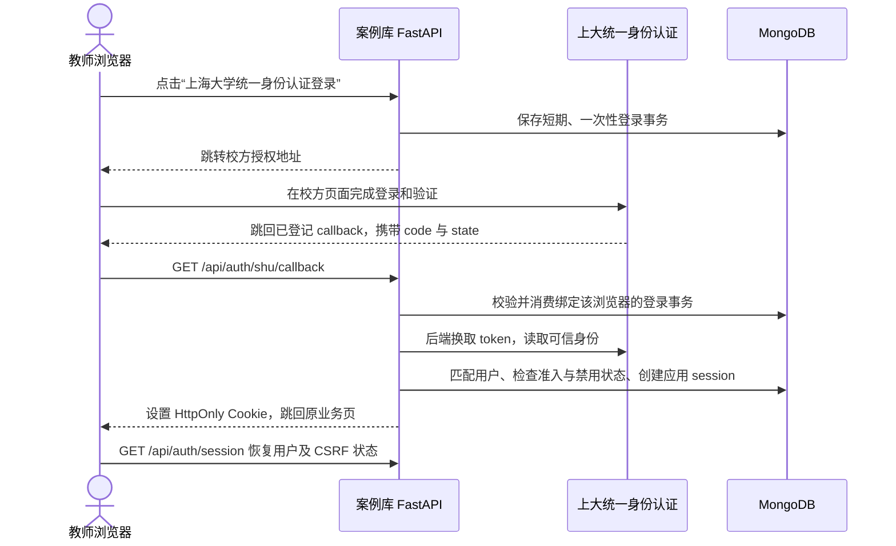

---
sources:
  shu_application: https://newits.shu.edu.cn/sytplb/bmfw/xttysfrzsq.htm
  shu_contact: https://newits.shu.edu.cn/fwdh.htm
  shu_live_login: https://selfreport.shu.edu.cn/
  shu_sso: https://newsso.shu.edu.cn/
  shu_carsi: https://lib.shu.edu.cn/info/1022/1668.htm
  authlib_fastapi: https://docs.authlib.org/en/v1.6.4/client/fastapi.html
  oauth_security: https://www.rfc-editor.org/info/rfc9700/
  local_auth: ../../backend/app/modules/auth/routes.py
  local_sessions: ../../backend/app/modules/auth/sessions.py
  local_users: ../../backend/app/modules/auth/service.py
  local_indexes: ../../backend/app/core/database.py
  local_permissions: ../../backend/app/modules/materials/service.py
  local_case_access: ../../backend/app/modules/cases/routes.py
  local_router: ../../frontend/src/router.js
  local_proxy: ../../deploy/nginx.conf
  local_dependencies: ../../backend/requirements.txt
  local_account_decision: ../adr/0018-production-and-demo-accounts.md
  local_operations: ../operations.md
---
# 上海大学统一身份认证接入
## 结论
技术上可接入。优先向校信息化工作办公室申请 OAuth 授权码应用，由 FastAPI 完成换码和身份验证，再建立现有 MongoDB 应用会话。公开证据确认上大现有应用采用授权码流程，但新应用可用协议、接口、属性和开通条件仍需校方确认；尚不能确定支持 OIDC 或 CAS。
## 校方公开证据
| 证据 | 已确认 | 未确认 |
| --- | --- | --- |
| `shu_application` | 信息办提供“系统统一身份认证申请”服务，说明向其他应用提供统一身份与数据授权接口。 | 页面未公开完整接口文档、申请表、审批时长或应用凭据领取方式。 |
| `shu_live_login` | 2026-09-13 未登录访问收到连续 302：`/Login.aspx` → `/LoginSSO.aspx` → `https://newsso.shu.edu.cn/oauth/authorize`，授权参数包含 `response_type=code`、`client_id`、`redirect_uri`、`scope`，最终进入校方登录页。 | 只观察公开跳转，未登录、未交换 code；token、用户信息和退出端点均未验证。已有应用参数不属于本项目。 |
| `shu_carsi` | 图书馆 2020 年公告证明上大曾通过 CARSI/Shibboleth 提供校外电子资源认证。 | 不能据此认定本案例库应走 CARSI，也不能当作新应用 SAML 接入许可。 |
| `shu_contact` | 信息办服务电话为 66133370、66133782。 | 统一认证集成负责人与具体申请流程需通过服务渠道确认。 |
OAuth 授权码流程不自动等于 OIDC。若校方只提供 OAuth，身份来自后端持 access token 调用的校方用户接口；只有校方确认 OIDC 后，才采用 discovery、ID Token、issuer、audience、nonce 和签名校验。不要根据入口路径猜 token/userinfo 地址。
## 接入路径

图中为建议流程，code/state 返回方式以校方接口契约为准。建议登记固定 HTTPS 回调 `/api/auth/shu/callback`；Vue 使用 hash router，不能登记 `/#/login`。校方密码仅输入校方页面，client secret 和 token 仅留在后端。
按应用独立生成并绑定浏览器的 state 防止登录请求串用，校方支持时启用 PKCE S256；回调地址与注册值一致，登录后返回地址只允许站内路径。现有 Strict 会话 Cookie 不可直接承担跨站登录事务关联；若为跨站 GET 回调，短期关联 Cookie 可采用 Secure、HttpOnly、SameSite=Lax，登录事务存 MongoDB 以支持多副本，完成后删除。POST 回调需要另行核对浏览器 Cookie 行为。
## 当前代码与改动点
| 接入面 | 当前行为 | 建议改动 |
| --- | --- | --- |
| 登录与会话 | `local_auth:44` 校验本地密码；`local_sessions:23` 创建随机 Cookie token、摘要记录及 CSRF token。 | 在 auth 模块增加学校登录与 callback；身份通过后复用 `create_session`，业务 API 继续使用应用会话。 |
| 用户标识 | `local_indexes:22` 只保证内部 id、username 唯一，业务资源按内部 user.id 归属。 | 对校方保证稳定唯一的身份键建立唯一映射；保留内部 user.id。姓名、邮箱或相同 username 不自动绑定已有账号，重复及并发首次登录不得生成多个用户。 |
| 密码耦合 | `local_users:23` 直接读取 password_hash，`:30` 返回 must_change_password；前后端均有强制改密判断。 | 校方身份不设置本地密码、不走首次改密。若决定正式账号统一使用 SSO，同步替换本地密码登录及 ADR 0018 的现行决定；是否需要独立运维账号须明确用途。 |
| 身份与权限 | `local_permissions:172` 以 campus_verified 或 admin 判断校内资料权限；当前普通 user 可创建案例。 | 根据校方可信属性及授权人群确认校内资格；管理员由平台显式授予。仅允许教师创作时，需要教职工属性或受控教师名单，不能把全校登录者直接赋予创作权限。 |
| 禁用与退出 | `local_sessions:38` 每次检查本地 active/token_version；退出只删除本应用 session，默认会话七天。 | SSO 不覆盖本地禁用或角色。与校方确定离职、毕业、停用后的撤销机制和最长资格陈旧时间；本应用退出与全校 SSO 退出分别定义。 |
| 前端 | `local_router:103` 使用 hash router，`frontend/src/session.js:28` 从后端恢复登录态。 | 登录入口改成学校登录按钮；成功后回到干净业务 URL，再调用现有 session 接口。 |
| 反代与部署 | `local_proxy:1` 用 `$request` 记录完整查询串，`:32` 转发当前连接 scheme；现有 Compose 为演示部署。 | callback 日志省略 code/ticket/token，并检查上游入口与应用日志；登记真实 HTTPS 域名，正确处理可信代理与外部回调地址。生产拓扑仍需按 `local_operations` 完成。 |
已有 httpx、PyMongo、FastAPI，没有 Authlib/CAS/SAML 协议客户端。OAuth/OIDC 优先评估 Authlib 的 FastAPI/Starlette 集成；官方示例已提供授权跳转与换码模式，临时登录事务存储需与现有 Mongo 会话组合，不能照搬示例的 Google 用户字段或 cookie 存储方式。只实现校方确认的一种协议。
## 向校方申请时确认
| 项目 | 所需信息 |
| --- | --- |
| 申请主体 | 由哪个校内单位提交、审批入口、业务及技术负责人、测试与正式应用是否分别登记。 |
| 协议与接口 | 新应用推荐 OAuth 2.0、OIDC 还是 CAS；授权、换码、用户信息、退出地址及文档；客户端认证方式、PKCE 支持、错误响应。 |
| 应用登记 | 本项目独立 client_id、凭据安全交付方式、精确 HTTPS 回调白名单、授权 scope、测试账号及联调环境。 |
| 身份属性 | 不变唯一标识及是否回收重用；姓名、工学号、部门、教师/学生身份、在校状态是否可提供及字段含义。 |
| 网络与上线 | 是否要求校内服务器、shu.edu.cn 域名、出口 IP 白名单；校外浏览器与服务端接口是否可达；上线审批要求。 |
| 身份生命周期 | 停用/离职是否推送、是否支持单点登出、学校退出对应用会话的预期，以及资格刷新周期。 |
可发送给信息办：拟为“强国有我”思政案例库申请上海大学统一身份认证接入，技术栈为 Vue 与 FastAPI，登录凭据由校方页面处理。请提供新应用接入流程、推荐协议和接口文档、应用注册及 HTTPS 回调要求、可授权的用户唯一标识与教职工属性、测试环境和退出/停用通知能力，并确认服务器及域名限制。
## 最小交付与验收
先取得校方登记与接口契约，打通“真实测试教师登录 → 校方可信身份映射 → 本地 session → 创建并保存自己的案例 → 退出后无法继续写入”。同时验证重复/并发登录仍归同一用户、普通用户不能进入管理后台、学生或未准入账号不能获得教师权限、校内与受限资料遵守原权限。
补测错误/过期/重放 code、错误 state、外部返回地址、校方接口超时、被本地禁用后重新 SSO，以及真实浏览器回调 Cookie；校方退出或停用必须按商定时效实际撤销应用访问。
已完成公开资料检索、未登录 HTTP 跳转核验和本地代码静态核对；尚未取得本项目校方登记、凭据和测试账号，未执行换码、用户属性读取或真实 SSO 端到端联调。
